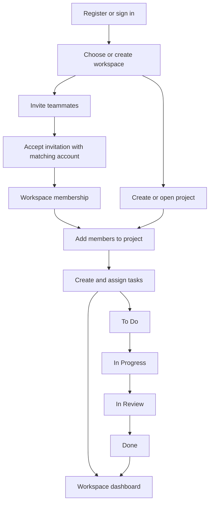

# ProjectFlow

ProjectFlow is a full-stack project and task management application for organizing teams into workspaces, planning projects, assigning work, and tracking progress through a shared dashboard and Kanban board.

**Live deployment:** [Open ProjectFlow](https://projectflow-frontend-topaz.vercel.app)

## Contents

- [Features](#features)
- [Application flow](#application-flow)
- [Roles and permissions](#roles-and-permissions)
- [Technology stack](#technology-stack)
- [Architecture and repository structure](#architecture-and-repository-structure)
- [Local development](#local-development)
- [Available commands](#available-commands)
- [API overview](#api-overview)
- [Deployment](#deployment)
- [Troubleshooting](#troubleshooting)

## Features

### Authentication and account recovery

- Register and sign in with email and password.
- Password hashing with bcrypt and JWT-based access authentication.
- Refresh-token cookies, automatic access-token refresh, and session initialization when reopening the app.
- Protected application routes and permission-aware controls.
- Sign out and clear the client session.
- Request a password reset by email and set a new password using a one-time link valid for 15 minutes.
- Password reset requests use a generic response to avoid revealing whether an email is registered, with a 60-second request cooldown.
- Send a notification email after a successful password change.

### Workspaces and team collaboration

- Create workspaces with a name and color.
- Browse your workspaces and switch workspace context.
- View workspace information, members, and summary statistics.
- Search and paginate member lists.
- Manage workspace member roles and remove members according to your permissions.
- View invitations addressed to your account.

### Email invitations

- Workspace owners and admins can invite teammates by email.
- Branded invitation emails link to an invitation page showing the workspace and inviter.
- Invitation links expire after seven days.
- The invitation page handles signed-out visitors, the correct signed-in account, and accounts whose email does not match the invitation.
- Accepting a valid invitation adds the user to the workspace as a member.
- Owners and admins can review workspace invitations and cancel pending invitations.
- Duplicate pending invitations and invitations to existing members are rejected.
- Invitations and password recovery share Gmail API delivery over HTTPS; Nodemailer composes the email content.

### Project management

- Create projects inside a workspace.
- Browse projects and open individual project overviews.
- Store project names, descriptions, colors, start dates, and end dates.
- Update project details and use `ACTIVE` or `ARCHIVED` project status.
- Delete projects with the required workspace permissions.
- Add existing workspace members to projects, update their project roles, and remove them.
- View and search project membership with pagination.

### Task management

- Create, view, edit, and delete tasks according to role and ownership permissions.
- Store a title, description, assignee, priority, and optional due date.
- Assign tasks to project members or leave them unassigned.
- Track tasks through four statuses: **To Do → In Progress → In Review → Done**.
- Set **Low**, **Medium**, or **High** priority.
- Switch between a task list and a Kanban board.
- Drag tasks between board columns to update their status when permitted.
- Search tasks and combine status, priority, and assignee filters, including unassigned tasks.
- Open a task details page and manage a task from its contextual actions.

### Dashboard and interface

- Select a workspace to see its project and task summary.
- See project counts, active projects, open work, completed work, completion percentage, overdue tasks, and work assigned to you.
- Review task distribution by status and recent project progress.
- Use an agenda of unfinished tasks ordered by due date, with all-task and personal-task views.
- Navigate between workspaces, project overviews, tasks, and project members.
- Responsive layouts, light and dark themes, loading placeholders, empty states, error feedback, confirmation dialogs, and toast notifications.
- Public home, privacy policy, and not-found pages.

## Application flow

### First-time user and workspace owner

1. Open the [live application](https://projectflow-frontend-topaz.vercel.app) and register an account.
2. Sign in and open the workspace area.
3. Create a workspace and choose its name and color. The creator becomes its owner.
4. Invite teammates using their email addresses.
5. Create a project in the workspace and enter its planning details.
6. Add workspace members to the project and assign appropriate project roles.
7. Create tasks, choose priorities and due dates, and assign them to project members.
8. Track execution in the list or board view, moving tasks through review to completion.
9. Use the dashboard to review progress, overdue work, and personal assignments.

### Invited teammate

1. Receive an invitation email and open its link.
2. Register or sign in with the email address that received the invitation.
3. Return to the invitation page if needed and accept it before it expires.
4. Open the joined workspace. A project manager can add you to the relevant projects.
5. Review project tasks, filter by your assignment, and update work as allowed by your permissions.

### Password recovery

1. Choose the forgot-password option and submit your account email.
2. Open the reset email and follow its link within 15 minutes.
3. Enter a new password. A successful reset consumes the link and triggers a confirmation email.
4. Sign in using the new password.

### Data and request flow



The React client sends API requests through Axios. Requests carry an access token when available; eligible unauthorized requests trigger a refresh and retry. Express routes authenticate requests, validate input where configured, and delegate business rules to services. Repositories read and write MongoDB through Mongoose. TanStack Query caches server data and refreshes affected queries after mutations; Redux holds authentication and selected-workspace state.

## Roles and permissions

Permissions depend on both workspace membership and project context. The server enforces authorization in addition to the client hiding or disabling restricted controls.

| Scope | Role | Responsibilities |
| --- | --- | --- |
| Workspace | `OWNER` | Create and manage projects, manage membership and invitations, and oversee tasks. Only the owner can manage workspace admin roles. |
| Workspace | `ADMIN` | Manage projects, invitations, and ordinary workspace members; oversee project members and tasks. |
| Workspace | `MEMBER` | Participate in workspace and project work, view permitted content, and create or update tasks. Task deletion is restricted by ownership. |
| Project | `PROJECT_ADMIN` | Manage project details and membership and oversee project tasks. |
| Project | `MEMBER` | View project content and members, create or update tasks, and delete owned tasks where permitted. |

Workspace ownership cannot be assigned, changed, or removed through the normal member-management endpoints. Workspace admins cannot manage other workspace admins. Project deletion requires workspace owner or admin authorization.

## Technology stack

| Layer | Technologies |
| --- | --- |
| Frontend | React 19, TypeScript, Vite 8, React Router 7 |
| Styling and UI | Tailwind CSS 4, Lucide icons, date utilities, toast notifications |
| Client state | Redux Toolkit, React Redux |
| Server state and HTTP | TanStack Query 5, Axios |
| Forms and validation | React Hook Form, Zod |
| Task interactions | dnd-kit |
| Backend | Node.js, Express 5, JavaScript ES modules |
| Database | MongoDB, Mongoose 9 |
| Authentication | JSON Web Tokens, bcrypt, cookie-parser |
| Email | Gmail API with OAuth credentials; Nodemailer for MIME composition |
| Testing | Vitest, React Testing Library, jsdom, Node.js test runner |
| Hosting configuration | Vercel frontend with an API rewrite to a Render backend |

## Architecture and repository structure

```text
ProjectFlow/
├── README.md
├── client/
│   └── project-flow/
│       ├── src/
│       │   ├── app/                 # Router, layouts, providers, store, public pages
│       │   ├── features/
│       │   │   ├── auth/
│       │   │   ├── dashboard/
│       │   │   ├── invitation/
│       │   │   ├── projects/
│       │   │   ├── tasks/
│       │   │   └── workspace/
│       │   ├── shared/              # UI, hooks, permissions, HTTP and session helpers
│       │   └── test/                # Frontend test setup
│       ├── public/
│       ├── vercel.json              # API proxy and SPA rewrites
│       └── package.json
├── server/
│   ├── src/
│   │   ├── config/
│   │   ├── constants/
│   │   ├── controllers/
│   │   ├── middlewares/
│   │   ├── models/
│   │   ├── repositories/
│   │   ├── routes/v1/
│   │   ├── services/
│   │   ├── utils/
│   │   ├── validations/
│   │   ├── app.js
│   │   └── server.js
│   ├── docs/gmail-troubleshooting.md
│   ├── test/
│   └── package.json
└── Screens' UI/                     # UI image assets
```

The core data relationships are **users → workspace membership → projects → tasks**. Workspaces embed workspace members, projects reference a workspace and embed project members, and tasks reference their workspace, project, creator, and optional assignee. Invitations track a workspace, invited email, inviter, token, expiry, and status.

## Local development

### Prerequisites

- Node.js compatible with the installed Vite 8 toolchain; Node.js 22.12+ is a suitable baseline.
- npm.
- A local MongoDB instance or a reachable MongoDB Atlas database.
- Gmail OAuth credentials if you want to exercise invitations and password recovery.

Run the following commands from the repository root unless stated otherwise. The frontend and backend have separate dependency installations; there is no root package script.

### 1. Install dependencies

```bash
cd server
npm ci
cd ../client/project-flow
npm ci
```

### 2. Configure the backend

```dotenv
PORT=5000
NODE_ENV=development
DB_URL=mongodb://127.0.0.1:27017/projectflow
CLIENT_URL=http://localhost:5173

JWT_ACCESS_SECRET=replace-with-a-long-random-access-secret
JWT_ACCESS_EXPIRES_IN=15m
JWT_REFRESH_SECRET=replace-with-a-different-long-random-refresh-secret
JWT_REFRESH_EXPIRES_IN=7d

GMAIL_CLIENT_ID=google-oauth-client-id
GMAIL_CLIENT_SECRET=google-oauth-client-secret
GMAIL_REFRESH_TOKEN=google-oauth-refresh-token
MAIL_FROM_EMAIL=authorized-sender@gmail.com
MAIL_FROM_NAME=ProjectFlow
```

| Variable | Purpose |
| --- | --- |
| `PORT` | API listening port; defaults to `5000`. |
| `NODE_ENV` | Runtime mode; controls production cookie settings and development error details. |
| `DB_URL` | MongoDB connection string. |
| `CLIENT_URL` | Allowed browser origin and base URL for invitation and password reset links. |
| `JWT_ACCESS_SECRET` / `JWT_REFRESH_SECRET` | Separate signing secrets for the two token types. |
| `JWT_ACCESS_EXPIRES_IN` / `JWT_REFRESH_EXPIRES_IN` | JWT lifetimes, such as `15m` and `7d`. |
| `GMAIL_CLIENT_ID` / `GMAIL_CLIENT_SECRET` / `GMAIL_REFRESH_TOKEN` | OAuth credentials used to authorize Gmail API delivery. |
| `MAIL_FROM_EMAIL` | Authorized sender email address. |
| `MAIL_FROM_NAME` | Sender display name; defaults to `ProjectFlow`. |

Use an OAuth refresh token authorized for `https://www.googleapis.com/auth/gmail.send` and enable the Gmail API for its Google Cloud project. Email delivery requires all four sender/credential settings checked by the email service. See the [Gmail troubleshooting guide](server/docs/gmail-troubleshooting.md) for authorization problems.

Keep real credentials out of commits and use your hosting provider's environment settings in production.

### 3. Configure the frontend

Create or update `client/project-flow/.env`:

```dotenv
VITE_API_BASE_URL=http://localhost:5000/api/v1
```

This variable is used in development. Production builds use the relative URL `/api/v1` and require an API proxy on the frontend host.

### 4. Start both applications

In one terminal:

```bash
cd server
npm run dev
```

In another terminal:

```bash
cd client/project-flow
npm run dev
```

Open `http://localhost:5173`. Vite may choose another port if that port is occupied; if so, update `CLIENT_URL` to match and restart the backend. Use the same hostname consistently for the browser and API during local development.

Check the backend with:

```bash
curl http://localhost:5000/health
```

The API also exposes `GET /api/v1/health`. Register an account through the UI, create a workspace, and follow the owner flow above. No seed command or demo credentials are provided.

## Available commands

### Frontend — `client/project-flow`

| Command | Purpose |
| --- | --- |
| `npm run dev` | Start the Vite development server. |
| `npm run build` | Run TypeScript build checks and create the production bundle in `dist/`. |
| `npm run preview` | Serve the production bundle locally; API calls still require an appropriate proxy. |
| `npm run lint` | Run ESLint. |
| `npm test` | Run the Vitest suite once. |

Frontend tests cover areas including authentication requests and session cleanup, password recovery pages, role permissions, dashboard behavior, theme handling, task interactions, and shared components/hooks.

### Backend — `server`

| Command | Purpose |
| --- | --- |
| `npm run dev` | Start the API with Nodemon. |
| `npm start` | Start the API with Node.js. |
| `node --test test/email.service.test.js` | Run the existing email service tests directly. |

The backend's `npm test` script is currently a placeholder that exits with an error; use the direct Node.js test command for the existing suite.

## API overview

All paths below are relative to `/api/v1`. Resource operations require authentication except public health checks, registration, login, password recovery, and invitation lookup. Refresh and logout use the session cookie.

For compactness, `W` means `/workspaces/:workspaceId` and `P` means `/workspaces/:workspaceId/projects/:projectId`.

| Area | Method and route | Action |
| --- | --- | --- |
| Health | `GET /health` | API availability check. |
| Auth | `POST /auth/register`, `POST /auth/login` | Register or sign in. |
| Auth | `POST /auth/refresh`, `POST /auth/logout` | Refresh or end a session. |
| Auth | `GET /auth/me`, `GET /auth/user/:userId` | Fetch current or identified user information. |
| Recovery | `POST /auth/forgot-password`, `POST /auth/reset-password` | Request or complete password recovery. |
| Workspaces | `POST /workspaces`, `GET /workspaces` | Create or list workspaces. |
| Workspaces | `GET /workspaces/:id` | Read a workspace. |
| Workspace members | `GET W/members` | List members. |
| Workspace members | `PATCH W/members/:userId`, `DELETE W/members/:userId` | Change a role or remove a member. |
| Projects | `POST W/projects`, `GET W/projects` | Create or list projects. |
| Projects | `GET P`, `PATCH P`, `DELETE P` | Read, update, or delete a project. |
| Project members | `GET P/members`, `POST P/members` | List or add project members. |
| Project members | `PATCH P/members/:userId`, `DELETE P/members/:userId` | Change a role or remove a member. |
| Tasks | `POST P/tasks`, `GET P/tasks` | Create or list tasks. |
| Tasks | `GET P/tasks/:taskId`, `PATCH P/tasks/:taskId`, `DELETE P/tasks/:taskId` | Read, update, or delete a task. |
| Invitations | `POST W/invitations`, `GET W/invitations` | Send or list workspace invitations. |
| Invitations | `GET /workspaces/invitations/my-pending` | List invitations for the signed-in user. |
| Invitations | `GET /workspaces/invitations/:token` | Look up an invitation publicly. |
| Invitations | `POST W/invitations/:token/accept` | Accept an invitation with the matching account. |
| Invitations | `DELETE W/invitations/:invitationId` | Cancel a pending invitation. |

## Deployment

The frontend deployment is available at **[projectflow-frontend-topaz.vercel.app](https://projectflow-frontend-topaz.vercel.app)**.

### Frontend on Vercel

- Set the project root directory to `client/project-flow`.
- Install dependencies with `npm ci`.
- Build with `npm run build` and publish `dist`.
- Keep the existing `vercel.json` rewrites: `/api/:path*` proxies to the backend, and the final rewrite serves `index.html` for client-side routes.
- The checked-in API destination is `https://projectflow-backend-u8ah.onrender.com/api/:path*`. Update it if deploying your own backend.

The proxy allows the frontend to call `/api/v1` on its own origin and keeps refresh-cookie requests first-party. Setting only `VITE_API_BASE_URL` does not change the production API destination.

### Backend on Render or another Node.js host

- Use `server` as the service root directory.
- Install with `npm ci` and start with `npm start`.
- Configure the backend environment variables above using the hosted MongoDB connection string and real email credentials.
- Set `NODE_ENV=production` and `CLIENT_URL=https://projectflow-frontend-topaz.vercel.app` for the supplied frontend, or use your own frontend origin.
- Keep the host-assigned `PORT` when supplied and ensure the database permits connections from the service.
- Use `/health` as the health-check path.

## Troubleshooting

| Symptom | Check |
| --- | --- |
| Backend exits before listening | Verify `DB_URL`, database availability, and database network access. Startup waits for MongoDB. |
| Browser requests fail in local development | Confirm `VITE_API_BASE_URL` includes `/api/v1`, the backend is running, and `CLIENT_URL` matches the frontend origin. Restart after changing environment files. |
| Production API requests fail | Check the `/api` rewrite destination in `vercel.json` and the backend health endpoint. |
| Session refresh fails | Check JWT secrets, expiry settings, cookies, HTTPS in production, and the frontend API proxy. |
| Invitation email cannot be sent | Check Gmail credentials, sender authorization, and backend logs. See [Gmail troubleshooting](server/docs/gmail-troubleshooting.md). |
| Password reset reports success but no email arrives | Check spam and backend delivery logs. The response intentionally does not reveal account existence or delivery failure. |
| Invitation cannot be accepted | Confirm it is pending, under seven days old, and opened while signed in with the invited email address. |
| An action is unavailable or returns forbidden | Check workspace role, project role, membership, and task ownership. |
| A frontend deep link fails after deployment | Ensure the host serves `index.html` for application routes after handling the API proxy. |